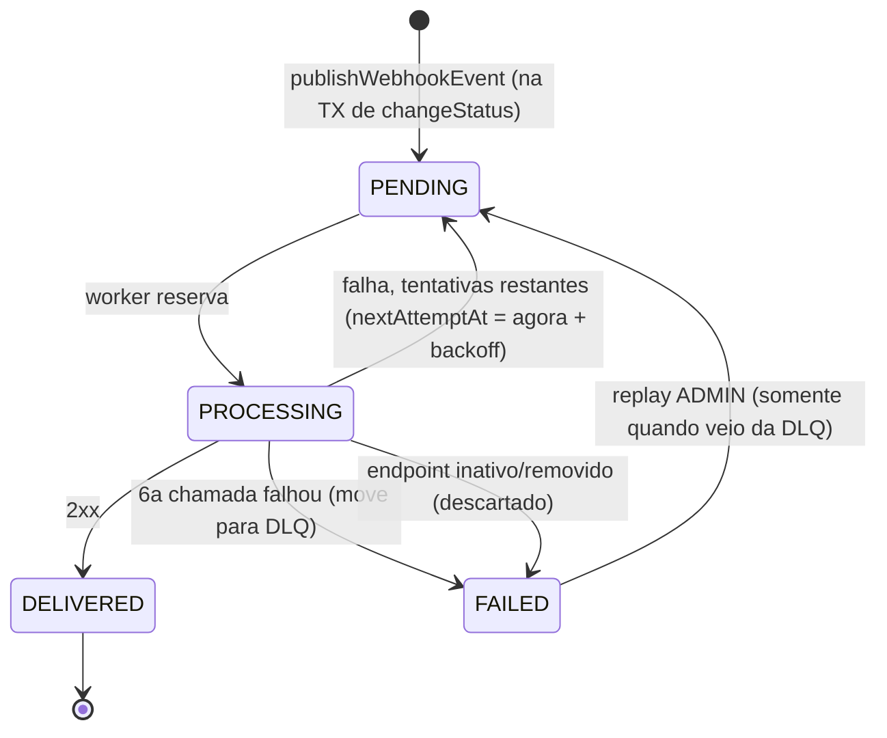
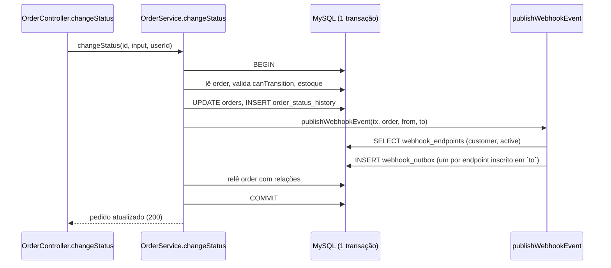
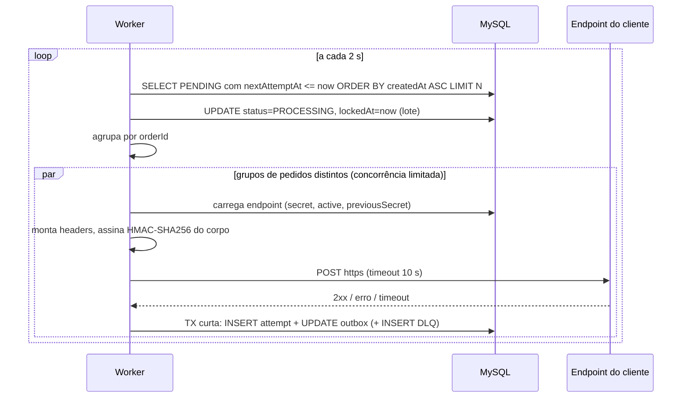

# FDD-001: Sistema de Webhooks de Notificação de Pedidos

## Metadados

| Campo | Valor |
| --- | --- |
| **Autor** | Gabriel Pantoja |
| **Status** | Rascunho para revisão (Larissa, Bruno e Diego, conforme [09:50] Larissa) |
| **Data** | 18-11-2026 |
| **Revisão de segurança** | Sofia, mínimo de 2 dias úteis antes do deploy ([09:46] Sofia) |
| **Documentos relacionados** | [PRD](./PRD.md) · [RFC](./RFC.md) · [ADRs](./adrs/README.md) · [Tracker](./TRACKER.md) |

**Convenção de rastreabilidade.** Tudo que vem da reunião cita `[hh:mm] Nome` (fonte: `TRANSCRICAO.md`). Tudo que vem do código cita o caminho do arquivo. O que é **escolha de implementação deste FDD**, sem decisão na reunião, está marcado com **(proposta FDD)** e consolidado na seção [13](#13-premissas-de-implementação-e-pontos-a-validar) para o time confirmar ou vetar na revisão.

---

## 1. Contexto e motivação técnica

Atlas Comercial, MaxDistribuição e Nova Cargo precisam ser avisados quando o status de um pedido muda, em menos de 10 segundos ([09:00] Marcos, [09:02] Marcos). Hoje a aplicação não tem eventos, filas nem webhooks, e os clientes fazem polling em `GET /orders`.

O ponto técnico crítico está em `OrderService.changeStatus` (`src/modules/orders/order.service.ts`). Ele abre uma transação com `this.prisma.$transaction` que:

1. lê o pedido com itens;
2. valida a transição com `canTransition` (`src/modules/orders/order.status.ts`);
3. debita ou repõe estoque;
4. atualiza `orders` e insere em `order_status_history`;
5. relê o pedido com relações para a resposta.

Uma chamada HTTP nessa transação acoplaria a latência do cliente à disponibilidade de mudanças de status de todos os outros pedidos, e um cliente fora do ar forçaria rollback de uma mudança válida ([09:04] Bruno). A solução decidida é o padrão **Outbox** no MySQL, com um **worker** em processo separado ([ADR-001](./adrs/ADR-001-outbox-no-mysql.md), [ADR-002](./adrs/ADR-002-worker-separado-em-polling.md)). Este documento detalha como construí-la.

## 2. Objetivos técnicos

| ID | Objetivo | Fonte |
| --- | --- | --- |
| OT-01 | Evento de webhook e mudança de status são **atômicos**: se o status commitou, o evento existe; se deu rollback, o evento some. | [09:06] Diego, [09:40] Bruno |
| OT-02 | Entrega em **menos de 10 s** no caminho feliz (até 2 s de espera do polling + chamada HTTP). | [09:02] Marcos, [09:10] Larissa |
| OT-03 | A latência ou queda de um cliente **não afeta** a API de pedidos. | [09:04] Bruno, [09:11] Diego |
| OT-04 | Autenticidade e integridade verificáveis pelo cliente: HMAC-SHA256, secret por endpoint, rotação com 24 h de convivência. | [09:19] Sofia, [09:22] Sofia |
| OT-05 | Semântica **at-least-once** com `X-Event-Id` para deduplicação no cliente. | [09:26] Larissa |
| OT-06 | Falhas tratadas por 5 retries com backoff e DLQ em tabela própria, com replay manual por `ADMIN`. | [09:17] Larissa, [09:36] Larissa |
| OT-07 | **Zero dependências e infraestrutura novas**: MySQL, Prisma, Express, Zod e Pino existentes. | [09:07] Diego, [09:30] Larissa |
| OT-08 | Módulo no mesmo padrão dos demais (controller, service, repository, routes, schemas) com códigos `WEBHOOK_*`. | [09:27] Bruno, [09:29] Larissa |

## 3. Escopo e exclusões

### 3.1 Dentro do escopo

- Tabelas `webhook_endpoints`, `webhook_outbox`, `webhook_delivery_attempts` e `webhook_dead_letter` (migration Prisma).
- Função `publishWebhookEvent(tx, order, fromStatus, toStatus)` chamada de dentro de `changeStatus`.
- Worker (`src/worker.ts`, `npm run worker`) com polling de 2 s, assinatura HMAC, timeout de 10 s, retry com backoff e DLQ.
- API: criar, editar, remover e listar webhooks de um customer; rotacionar secret; histórico de entregas; replay de DLQ (`ADMIN`).
- Evento único `order.status_changed` ([09:43] Diego).

### 3.2 Fora do escopo (decidido ou adiado na reunião)

| Item | Situação | Fonte |
| --- | --- | --- |
| Notificação por e-mail ao cliente quando o webhook falha | Próxima fase, depois de medir impacto | [09:37] Larissa |
| Rate limiting de saída por cliente | "Observar e decidir depois" | [09:39] Larissa |
| Dashboard visual para o cliente | Projeto separado do time de frontend; só endpoints | [09:40] Larissa |
| Arquivamento de eventos entregues (~30 dias) | Fora do escopo da feature | [09:08] Diego |
| Múltiplos workers / ordering global | Limitação conhecida; single-worker | [09:13] Larissa |
| Endurecer permissões do CRUD | "Mais pra frente" | [09:37] Sofia |
| Itens do pedido no payload | Cliente consulta `GET /orders/:id` | [09:43] Diego |
| Webhooks de entrada (cliente → nós) | Só outbound | [09:02] Marcos |

### 3.3 Exclusões de implementação (esclarecimentos deste FDD)

- Somente `changeStatus` emite evento. `OrderService.create` (que grava o histórico inicial `null → PENDING`) **não** emite, pois a reunião trata de "mudança de status" ([09:00] Marcos). **(proposta FDD)**
- Não há exportação de métricas via endpoint Prometheus nem tracing distribuído nesta fase (seção 9).

---

## 4. Modelo de dados

Todas as chaves são UUID `@db.Char(36)`, como no restante do `prisma/schema.prisma` ([09:51] Larissa). Nomes de tabela em `snake_case` via `@@map`, como as demais.

```prisma
enum WebhookOutboxStatus {
  PENDING      // aguardando envio (inclui eventos aguardando backoff)
  PROCESSING   // reservado pelo worker
  DELIVERED    // 2xx recebido
  FAILED       // terminal: foi para a DLQ ou foi descartado (endpoint inativo)
}

model WebhookEndpoint {
  id                      String    @id @default(uuid()) @db.Char(36)
  customerId              String    @db.Char(36)
  url                     String    @db.VarChar(2048)
  events                  Json      // OrderStatus[] assinados, ex.: ["SHIPPED","DELIVERED"]
  secret                  String    @db.Char(64)
  previousSecret          String?   @db.Char(64)
  previousSecretExpiresAt DateTime?
  active                  Boolean   @default(true)
  createdAt               DateTime  @default(now())
  updatedAt               DateTime  @updatedAt

  customer Customer        @relation(fields: [customerId], references: [id])
  outbox   WebhookOutbox[]

  @@index([customerId, active])
  @@map("webhook_endpoints")
}

model WebhookOutbox {
  id            String              @id @default(uuid()) @db.Char(36) // = event_id = X-Event-Id
  webhookId     String              @db.Char(36)
  orderId       String              @db.Char(36)                       // sem FK: o evento é um snapshot imutável
  eventType     String              @db.VarChar(64)                    // "order.status_changed"
  payload       Json                                                   // snapshot renderizado na inserção
  status        WebhookOutboxStatus @default(PENDING)
  attemptCount  Int                 @default(0)
  nextAttemptAt DateTime            @default(now())
  lockedAt      DateTime?
  lastError     String?             @db.VarChar(500)
  createdAt     DateTime            @default(now())
  deliveredAt   DateTime?

  webhook  WebhookEndpoint          @relation(fields: [webhookId], references: [id], onDelete: Cascade)
  attempts WebhookDeliveryAttempt[]

  @@index([status, nextAttemptAt])
  @@index([createdAt])
  @@index([webhookId])
  @@map("webhook_outbox")
}

model WebhookDeliveryAttempt {
  id            String   @id @default(uuid()) @db.Char(36)
  outboxId      String   @db.Char(36)
  webhookId     String   @db.Char(36)
  attemptNumber Int
  success       Boolean
  statusCode    Int?
  responseBody  String?  @db.Text      // truncado (proposta FDD: 2 KB)
  durationMs    Int
  errorCode     String?  @db.VarChar(64)
  attemptedAt   DateTime @default(now())

  outbox WebhookOutbox @relation(fields: [outboxId], references: [id], onDelete: Cascade)

  @@index([webhookId, attemptedAt])
  @@map("webhook_delivery_attempts")
}

model WebhookDeadLetter {
  id             String    @id @default(uuid()) @db.Char(36)
  outboxId       String    @unique @db.Char(36)
  webhookId      String    @db.Char(36)
  orderId        String    @db.Char(36)
  payload        Json
  failureReason  String    @db.VarChar(64)   // WEBHOOK_RETRIES_EXHAUSTED
  lastStatusCode Int?
  lastError      String?   @db.VarChar(500)
  attempts       Int
  failedAt       DateTime  @default(now())
  replayedAt     DateTime?
  replayedById   String?   @db.Char(36)

  @@index([webhookId])
  @@map("webhook_dead_letter")
}
```

**Justificativas**

- `webhook_outbox.id` **é** o `event_id`: "UUID gerado quando o evento entra na outbox" ([09:25] Diego). O mesmo valor vai no payload e em `X-Event-Id`.
- Um registro de outbox **por endpoint inscrito**, e não por mudança de status, porque `X-Webhook-Id` identifica o cadastro de destino ([09:44] Sofia) e cada destino tem seu próprio ciclo de retry.
- Índices em status e `created_at` ([09:08] Diego); o composto `(status, nextAttemptAt)` serve ao polling com backoff **(proposta FDD)**.
- `orderId` sem FK: `OrderService.delete` permite apagar pedidos `PENDING` ou `CANCELLED` (`src/modules/orders/order.service.ts`) e o evento é um snapshot que não deve impedir isso nem sumir junto.
- A DLQ guarda payload, motivo e timestamp ([09:18] Diego). `replayedAt` e `replayedById` sustentam a auditoria do replay ([09:36] Sofia) e impedem replay duplicado **(proposta FDD)**.
- Ciclo de vida do status:



---

## 5. Fluxos detalhados

### 5.1 Criação do evento na outbox

Arquivo novo: `src/modules/webhooks/webhook.publisher.ts`, exportando `publishWebhookEvent`. É uma função que recebe o `tx` e não exige injetar repository no `OrderService` ([09:41] Bruno, [09:41] Diego).

```ts
// assinatura (ver ADR-001)
export async function publishWebhookEvent(
  tx: Prisma.TransactionClient,
  order: Pick<Order, 'id' | 'orderNumber' | 'customerId' | 'totalCents'>,
  fromStatus: OrderStatus,
  toStatus: OrderStatus,
): Promise<void>;
```

Passos:

1. Buscar `tx.webhookEndpoint.findMany({ where: { customerId: order.customerId, active: true } })`.
2. **Filtrar na inserção**: manter só os endpoints cujo `events` contém `toStatus`. Se não sobrar nenhum, retornar sem inserir nada ([09:34] Bruno, [09:34] Diego).
3. Para cada endpoint, gerar `eventId = uuidv4()` (dependência `uuid` já existente, usada em `src/middlewares/request-logger.middleware.ts`) e **renderizar o snapshot** do payload (seção 6.2) ([09:52] Larissa).
4. Medir `Buffer.byteLength(JSON.stringify(payload))`. Se `> 65_536` bytes, lançar `WebhookPayloadTooLargeError` ([09:24] Larissa). Nenhum envio é feito truncado ([09:23] Sofia).
5. `tx.webhookOutbox.createMany({ data })` com `status: PENDING`, `attemptCount: 0`, `nextAttemptAt: now`.

Qualquer exceção propaga e a transação inteira sofre rollback, que é o comportamento desejado: "Não pode ter caso de status mudar e evento não sair" ([09:40] Bruno).



Ponto de inserção no código: **depois** de `tx.orderStatusHistory.create(...)` e **antes** da releitura `refreshed`, passando `order` (lido no início da transação, que ainda tem o status antigo) e os valores `from` e `to` já calculados.

### 5.2 Processamento pelo worker

Entry-point `src/worker.ts` (análoga a `src/server.ts`) e lógica em `src/modules/webhooks/webhook.processor.ts` (um dos dois nomes sugeridos em [09:28] Bruno; o outro era `webhook.worker.ts`) ([09:11] Larissa, [09:28] Bruno). O processo cria seu próprio `PrismaClient` com `createPrismaClient()` de `src/config/database.ts`, mesma `DATABASE_URL` ([09:30] Bruno).

**Bootstrap**

1. Carregar `env` e o logger.
2. Recuperação de órfãos: `UPDATE webhook_outbox SET status='PENDING', lockedAt=NULL WHERE status='PROCESSING'`. Num único worker, qualquer `PROCESSING` na partida é de um processo que morreu. **(proposta FDD)**
3. Iniciar o loop; registrar `SIGINT`/`SIGTERM` como em `src/server.ts` (`shutdown_initiated`, parar o loop, esperar o ciclo corrente, `prisma.$disconnect()`).

**Ciclo** (a cada 2 s, medido do fim de um ciclo ao início do próximo, via `setTimeout` encadeado, sem sobreposição) ([09:09] Diego):



- **Lote pequeno** ([09:08] Diego): `WEBHOOK_WORKER_BATCH_SIZE`, padrão 10 **(proposta FDD)**.
- **Ordem**: a consulta ordena por `createdAt ASC`; eventos do mesmo `orderId` são processados **sequencialmente** dentro do ciclo. Isso preserva a ordem por `order_id` com um único worker ([09:12] Diego, [09:13] Larissa).
- **Concorrência entre pedidos diferentes**: grupos distintos rodam em paralelo (limite `WEBHOOK_WORKER_CONCURRENCY`, padrão 5), para que um cliente lento (timeout de 10 s) não bloqueie os demais e ameace o requisito de 10 s. Não altera a garantia de ordem, que é por pedido. **(proposta FDD, ver risco R-02)**
- **HTTP**: `fetch` global do Node ≥ 20 (`engines` em `package.json`), com `AbortSignal.timeout(10_000)` ([09:42] Diego), `redirect: 'manual'` (3xx conta como falha) **(proposta FDD)**. Sucesso = qualquer `2xx`.
- **Resultado**: toda tentativa grava uma linha em `webhook_delivery_attempts` (base de `GET /webhooks/:id/deliveries`) e atualiza a outbox numa **transação curta, fora da chamada HTTP**.
- **Endpoint inativo ou removido** no momento do envio: o evento vai para `FAILED` com `lastError = WEBHOOK_ENDPOINT_INACTIVE`, sem retry e sem DLQ. **(proposta FDD)**

### 5.3 Retry com backoff

Política de [ADR-003](./adrs/ADR-003-retry-com-backoff-e-dlq.md): **1 min, 5 min, 30 min, 2 h, 12 h** ([09:17] Larissa).

```ts
export const RETRY_DELAYS_MS = [60_000, 300_000, 1_800_000, 7_200_000, 43_200_000] as const;
```

**Interpretação da contagem.** A soma dos intervalos é 876 min (≈ 14,6 h), que bate com "quase 15 horas entre primeira falha e última tentativa" ([09:17] Diego). Isso só fecha se houver **uma tentativa inicial + 5 retries** (6 chamadas HTTP no total); com 5 chamadas, o intervalo de 12 h nunca seria usado. O FDD adota essa leitura, e o time deve confirmá-la na revisão (seção 13, item P-01).

Após cada chamada com falha, com `n = attemptCount` já incrementado:

| `n` (chamadas feitas) | Ação | Próxima tentativa |
| --- | --- | --- |
| 1 | `status=PENDING`, `nextAttemptAt = now + 1 min` | +1 min |
| 2 | idem `+ 5 min` | +5 min |
| 3 | idem `+ 30 min` | +30 min |
| 4 | idem `+ 2 h` | +2 h |
| 5 | idem `+ 12 h` | +12 h |
| 6 | **DLQ** (5.4) | nenhuma |

Conta como **falha**: resposta não `2xx`, 3xx, erro de rede/DNS/TLS e timeout de 10 s ([09:42] Diego).

### 5.4 DLQ e replay

**Movimentação para a DLQ** (6ª falha), numa única transação:

1. `INSERT webhook_dead_letter` com `payload`, `failureReason = WEBHOOK_RETRIES_EXHAUSTED`, `lastError` com o código `WEBHOOK_*` da última falha, `lastStatusCode`, `lastError`, `attempts`, `failedAt` ([09:18] Diego).
2. `UPDATE webhook_outbox SET status='FAILED'`. A linha sai do índice de polling e permanece como referência do histórico.
3. Log `webhook_moved_to_dlq` em nível `error`.

**Replay**: `POST /api/v1/admin/webhooks/dead-letter/:id/replay` ([09:18] Diego, [09:35] Diego), restrito a `ADMIN` com `requireRole('ADMIN')` ([09:36] Larissa):

1. Buscar a linha da DLQ; inexistente → `WEBHOOK_DEAD_LETTER_NOT_FOUND`; já reprocessada (`replayedAt != null`) → `WEBHOOK_DEAD_LETTER_ALREADY_REPLAYED` **(proposta FDD)**.
2. Em transação: recolocar a **mesma** linha da outbox como `PENDING`, `attemptCount=0`, `nextAttemptAt=now`, `lockedAt=null`; marcar `replayedAt` e `replayedById = req.user.id` na DLQ. Reaproveitar o mesmo `event_id` mantém a deduplicação do cliente válida ([ADR-005](./adrs/ADR-005-entrega-at-least-once-com-x-event-id.md)).
3. **Logar quem executou** (`webhook_dlq_replayed` com `userId`, `deadLetterId`, `eventId`) ([09:36] Sofia).

Se o endpoint foi removido entre a falha e o replay, a FK com `onDelete: Cascade` já terá apagado a linha da outbox; o replay responde `WEBHOOK_NOT_FOUND`.

### 5.5 Rotação de secret

1. `previousSecret ← secret`, `previousSecretExpiresAt ← now + 24 h`, `secret ← novo valor` ([09:21] Sofia).
2. Enquanto `now < previousSecretExpiresAt`, o worker envia **duas assinaturas** em `X-Signature` (seção 6.9), para que o cliente valide com qualquer uma das secrets durante a migração.
3. Passado o prazo, o worker ignora `previousSecret` (a expiração é avaliada na hora do envio, sem job de limpeza); o valor é zerado na próxima rotação ou edição. **(proposta FDD)**

---

## 6. Contratos públicos

Prefixo base da API: `/api/v1` (`src/app.ts`). Todos os endpoints exigem `Authorization: Bearer <JWT>` (`authenticate`). Respostas de erro seguem o formato central de `src/middlewares/error.middleware.ts`:

```json
{ "error": { "code": "WEBHOOK_NOT_FOUND", "message": "Webhook not found", "details": {} } }
```

Campos JSON de **resposta da API** seguem o padrão camelCase do projeto (ex.: `totalCents`, `orderNumber`); o **payload do webhook enviado ao cliente** usa snake_case, conforme definido em [09:43] Diego.

O `customerId` vem no **body** (criação) ou na **query** (listagem), nunca do JWT, porque o JWT é de um usuário operador ([09:32] Larissa). Uso de query na listagem é **(proposta FDD)**, já que `GET` não tem body.

Autorização: qualquer role autenticada nos endpoints 6.1 a 6.6; `ADMIN` obrigatório no 6.7 ([09:36] Larissa, [09:37] Sofia).

### 6.1 `POST /api/v1/webhooks`: cadastrar webhook

**Request**

```json
{
  "customerId": "8f14e45f-ceea-4672-a2a1-6c3a1c0b9d11",
  "url": "https://erp.atlascomercial.example/hooks/oms",
  "events": ["SHIPPED", "DELIVERED"]
}
```

| Campo | Regra |
| --- | --- |
| `customerId` | UUID de um `Customer` existente |
| `url` | `https` obrigatório, máx. 2048 caracteres ([09:23] Sofia) |
| `events` | array não vazio de `OrderStatus` (`PENDING`, `PAID`, `PROCESSING`, `SHIPPED`, `DELIVERED`, `CANCELLED`), sem repetição ([09:33] Marcos) |

**Response `201 Created`**: a `secret` é gerada pela plataforma e **só é exibida aqui e na rotação** ([09:31] Marcos).

```json
{
  "id": "2b7c1a90-5d3e-4f0a-9b61-0c4d7e8a1f23",
  "customerId": "8f14e45f-ceea-4672-a2a1-6c3a1c0b9d11",
  "url": "https://erp.atlascomercial.example/hooks/oms",
  "events": ["SHIPPED", "DELIVERED"],
  "active": true,
  "secret": "e3b0c44298fc1c149afbf4c8996fb92427ae41e4649b934ca495991b7852b855",
  "createdAt": "2026-11-18T14:03:21.482Z",
  "updatedAt": "2026-11-18T14:03:21.482Z"
}
```

| Status | Código | Quando |
| --- | --- | --- |
| 201 | n/a | Criado |
| 400 | `WEBHOOK_INVALID_URL` | URL não é `https` ou é malformada |
| 400 | `VALIDATION_ERROR` | `events` vazio/inválido, `customerId` não é UUID |
| 401 | `UNAUTHORIZED` | JWT ausente ou inválido |
| 404 | `WEBHOOK_CUSTOMER_NOT_FOUND` | `customerId` inexistente |

### 6.2 `GET /api/v1/webhooks?customerId=:uuid`: listar webhooks de um customer

Query: `customerId` (obrigatório, UUID), `page` (padrão 1), `pageSize` (padrão 20, máx. 100), no mesmo formato de `listCustomersQuerySchema` em `src/modules/customers/customer.schemas.ts`. A resposta usa `paginated(...)` de `src/shared/http/response.ts`. **A `secret` nunca é retornada** neste endpoint.

**Response `200 OK`**

```json
{
  "data": [
    {
      "id": "2b7c1a90-5d3e-4f0a-9b61-0c4d7e8a1f23",
      "customerId": "8f14e45f-ceea-4672-a2a1-6c3a1c0b9d11",
      "url": "https://erp.atlascomercial.example/hooks/oms",
      "events": ["SHIPPED", "DELIVERED"],
      "active": true,
      "secretRotatedAt": null,
      "createdAt": "2026-11-18T14:03:21.482Z",
      "updatedAt": "2026-11-18T14:03:21.482Z"
    }
  ],
  "pagination": { "page": 1, "pageSize": 20, "total": 1, "totalPages": 1 }
}
```

| Status | Código | Quando |
| --- | --- | --- |
| 200 | n/a | Lista (vazia se não houver webhooks) |
| 400 | `VALIDATION_ERROR` | `customerId` ausente ou não UUID |
| 401 | `UNAUTHORIZED` | JWT ausente ou inválido |

### 6.3 `PATCH /api/v1/webhooks/:id`: editar webhook

**Request** (todos opcionais, ao menos um; mesmas regras de 6.1)

```json
{ "events": ["PAID", "SHIPPED", "DELIVERED", "CANCELLED"], "active": true }
```

**Response `200 OK`**: o objeto da listagem 6.2 (sem `secret`).

| Status | Código | Quando |
| --- | --- | --- |
| 200 | n/a | Atualizado |
| 400 | `WEBHOOK_INVALID_URL` | Nova URL não `https` |
| 400 | `VALIDATION_ERROR` | Body vazio ou campos inválidos |
| 401 | `UNAUTHORIZED` | JWT ausente ou inválido |
| 404 | `WEBHOOK_NOT_FOUND` | `:id` inexistente |

Efeito: o filtro `events` e `active` valem para eventos **futuros**. Eventos já na outbox não são refiltrados (o filtro é aplicado na inserção, [09:34] Bruno).

### 6.4 `DELETE /api/v1/webhooks/:id`: remover webhook

**Response `204 No Content`** (sem corpo, como `DELETE /orders/:id`).

| Status | Código | Quando |
| --- | --- | --- |
| 204 | n/a | Removido |
| 401 | `UNAUTHORIZED` | JWT ausente ou inválido |
| 404 | `WEBHOOK_NOT_FOUND` | `:id` inexistente |

Semântica **(proposta FDD)**: remoção definitiva; eventos pendentes, tentativas e outbox do endpoint são apagados em cascata (`onDelete: Cascade`). A DLQ mantém as linhas já movidas, para auditoria. Para pausar sem perder histórico, use `PATCH { "active": false }`.

### 6.5 `POST /api/v1/webhooks/:id/rotate-secret`: rotacionar secret

Sem body. Gera nova secret; a anterior segue válida por 24 h ([09:21] Sofia).

**Response `200 OK`**

```json
{
  "id": "2b7c1a90-5d3e-4f0a-9b61-0c4d7e8a1f23",
  "secret": "9f86d081884c7d659a2feaa0c55ad015a3bf4f1b2b0b822cd15d6c15b0f00a08",
  "previousSecretExpiresAt": "2026-11-19T14:10:02.117Z"
}
```

| Status | Código | Quando |
| --- | --- | --- |
| 200 | n/a | Rotacionada |
| 401 | `UNAUTHORIZED` | JWT ausente ou inválido |
| 404 | `WEBHOOK_NOT_FOUND` | `:id` inexistente |

### 6.6 `GET /api/v1/webhooks/:id/deliveries`: histórico de entregas

"Últimos 100 webhooks enviados, sucesso/falha, payload, response, tempo de resposta" ([09:34] Marcos). Ordenado por `attemptedAt DESC`; `pageSize` máx. 100, padrão 20. Filtro opcional `success=true|false` **(proposta FDD)**.

**Response `200 OK`**

```json
{
  "data": [
    {
      "id": "c1d2e3f4-0a1b-4c2d-8e3f-5a6b7c8d9e01",
      "eventId": "7d2f6a10-3b8c-4e5d-9a41-b2c3d4e5f607",
      "attemptNumber": 1,
      "success": true,
      "statusCode": 200,
      "responseBody": "{\"received\":true}",
      "durationMs": 184,
      "errorCode": null,
      "attemptedAt": "2026-11-18T14:20:04.311Z",
      "payload": {
        "event_id": "7d2f6a10-3b8c-4e5d-9a41-b2c3d4e5f607",
        "event_type": "order.status_changed",
        "timestamp": "2026-11-18T14:20:02.095Z",
        "order_id": "41f0a6b2-9c7d-4e18-a5b3-6d2e1f0c8a97",
        "order_number": "ORD-000123",
        "from_status": "PROCESSING",
        "to_status": "SHIPPED",
        "customer_id": "8f14e45f-ceea-4672-a2a1-6c3a1c0b9d11",
        "total_cents": 125000
      }
    },
    {
      "id": "a0b1c2d3-4e5f-4607-8192-a3b4c5d6e7f8",
      "eventId": "0e9d8c7b-6a5f-4e3d-8c2b-1a0f9e8d7c6b",
      "attemptNumber": 2,
      "success": false,
      "statusCode": null,
      "responseBody": null,
      "durationMs": 10001,
      "errorCode": "WEBHOOK_DELIVERY_TIMEOUT",
      "attemptedAt": "2026-11-18T14:12:30.002Z",
      "payload": { "event_id": "0e9d8c7b-6a5f-4e3d-8c2b-1a0f9e8d7c6b", "...": "..." }
    }
  ],
  "pagination": { "page": 1, "pageSize": 20, "total": 2, "totalPages": 1 }
}
```

| Status | Código | Quando |
| --- | --- | --- |
| 200 | n/a | Histórico (pode ser vazio) |
| 400 | `VALIDATION_ERROR` | `:id` não UUID, paginação inválida |
| 401 | `UNAUTHORIZED` | JWT ausente ou inválido |
| 404 | `WEBHOOK_NOT_FOUND` | `:id` inexistente |

### 6.7 `POST /api/v1/admin/webhooks/dead-letter/:id/replay`: replay de DLQ (`ADMIN`)

Sem body. `:id` é o id da linha em `webhook_dead_letter`.

**Response `200 OK`**

```json
{
  "deadLetterId": "5a4b3c2d-1e0f-4a9b-8c7d-6e5f4a3b2c1d",
  "eventId": "0e9d8c7b-6a5f-4e3d-8c2b-1a0f9e8d7c6b",
  "status": "PENDING",
  "replayedAt": "2026-11-18T16:45:10.508Z",
  "replayedById": "d4c3b2a1-0f9e-4d8c-b7a6-5f4e3d2c1b0a"
}
```

| Status | Código | Quando |
| --- | --- | --- |
| 200 | n/a | Evento recolocado na outbox como pendente |
| 401 | `UNAUTHORIZED` | JWT ausente ou inválido |
| 403 | `FORBIDDEN` | Role diferente de `ADMIN` (`requireRole`) |
| 404 | `WEBHOOK_DEAD_LETTER_NOT_FOUND` | `:id` inexistente |
| 404 | `WEBHOOK_NOT_FOUND` | Endpoint de destino foi removido |
| 409 | `WEBHOOK_DEAD_LETTER_ALREADY_REPLAYED` | Já reprocessado |

### 6.8 Contrato de saída: requisição enviada ao cliente

`POST <url cadastrada>`

| Header | Valor | Fonte |
| --- | --- | --- |
| `Content-Type` | `application/json` | [09:44] Diego |
| `X-Event-Id` | UUID do evento (= `webhook_outbox.id`), estável entre retries | [09:25] Diego |
| `X-Webhook-Id` | id do `webhook_endpoints` de destino | [09:44] Sofia |
| `X-Timestamp` | instante do envio, ISO 8601 UTC (formato **proposta FDD**) | [09:44] Diego |
| `X-Signature` | `sha256=<hex>` (formato **proposta FDD**, ver 6.9) | [09:20] Sofia |

**Body** (snapshot da inserção; sem itens) ([09:43] Diego):

```json
{
  "event_id": "7d2f6a10-3b8c-4e5d-9a41-b2c3d4e5f607",
  "event_type": "order.status_changed",
  "timestamp": "2026-11-18T14:20:02.095Z",
  "order_id": "41f0a6b2-9c7d-4e18-a5b3-6d2e1f0c8a97",
  "order_number": "ORD-000123",
  "from_status": "PROCESSING",
  "to_status": "SHIPPED",
  "customer_id": "8f14e45f-ceea-4672-a2a1-6c3a1c0b9d11",
  "total_cents": 125000
}
```

`timestamp` é o instante da mudança de status (momento da inserção na outbox); `X-Timestamp` é o instante do envio e muda a cada tentativa.

**Resposta esperada do cliente**: qualquer `2xx` em até 10 s. O corpo da resposta é ignorado, exceto para registro (truncado) no histórico.

### 6.9 Assinatura do corpo

- `signature = HMAC_SHA256(secret, rawBody)` em hexadecimal, calculada sobre os **bytes exatos** enviados ([09:22] Sofia). O worker serializa o payload **uma vez** e usa a mesma string para assinar e enviar. Implementação com `node:crypto` (`createHmac`), sem dependência nova.
- Fora da rotação: `X-Signature: sha256=<hex>`.
- Durante os 24 h de rotação: `X-Signature: sha256=<hex_nova>,sha256=<hex_anterior>`; o cliente aceita se **qualquer** uma conferir **(proposta FDD)**.
- O cliente deve comparar com função de tempo constante, rejeitar `X-Timestamp` fora de uma janela que ele escolher e deduplicar por `X-Event-Id`. Esses três pontos vão para o portal de desenvolvedor ([09:26] Marcos).
- Observação para a revisão de segurança: o `X-Timestamp` **não** entra no HMAC (a decisão foi assinar o corpo). Ele detecta replay apenas por convenção do cliente (P-03).

---

## 7. Matriz de erros previstos

Classes novas em `src/modules/webhooks/webhook.errors.ts`, derivadas de `AppError` / classes de `src/shared/errors/http-errors.ts`, no mesmo molde de `InsufficientStockError` (que estende `UnprocessableEntityError` com um código próprio) ([09:28] Bruno, [09:29] Larissa).

### 7.1 Erros de API (retornados pelo `errorMiddleware`)

| Código | HTTP | Classe base | Origem / gatilho | Retentável |
| --- | --- | --- | --- | --- |
| `WEBHOOK_NOT_FOUND` | 404 | `AppError` direto (o `NotFoundError` fixa o código `NOT_FOUND`) | `:id` de webhook inexistente | Não |
| `WEBHOOK_CUSTOMER_NOT_FOUND` | 404 | `AppError` direto | `customerId` inexistente no cadastro | Não |
| `WEBHOOK_INVALID_URL` | 400 | `BadRequestError` | URL não `https` ou malformada | Não |
| `WEBHOOK_PAYLOAD_TOO_LARGE` | 422 | `UnprocessableEntityError` | Snapshot > 64 KB na inserção (5.1); aborta a TX de `changeStatus` | Não |
| `WEBHOOK_DEAD_LETTER_NOT_FOUND` | 404 | `AppError` direto | Replay de id inexistente | Não |
| `WEBHOOK_DEAD_LETTER_ALREADY_REPLAYED` | 409 | `ConflictError` | Replay de item já reprocessado | Não |

Erros genéricos **reaproveitados sem alteração** (`src/middlewares/error.middleware.ts`): `VALIDATION_ERROR` 400 (Zod via `validate`), `UNAUTHORIZED` 401, `FORBIDDEN` 403 (`requireRole`), `CONFLICT` e `NOT_FOUND` do tratamento de Prisma (`P2002`, `P2025`) e `INTERNAL_SERVER_ERROR` 500. O service deve checar existência explicitamente e lançar `WEBHOOK_*`, em vez de depender do `P2025`.

### 7.2 Erros do worker (não viram resposta HTTP)

Registrados em `webhook_delivery_attempts.errorCode`, em `webhook_outbox.lastError` e nos logs. Na DLQ, `failureReason` guarda `WEBHOOK_RETRIES_EXHAUSTED` e `lastError` guarda o código da última falha.

| Código | Gatilho | Tratamento |
| --- | --- | --- |
| `WEBHOOK_DELIVERY_FAILED` | Resposta não `2xx` (inclui 3xx) ou erro de rede/DNS/TLS | Retry/backoff (5.3) |
| `WEBHOOK_DELIVERY_TIMEOUT` | Sem resposta em 10 s ([09:42] Diego) | Retry/backoff |
| `WEBHOOK_SECRET_REQUIRED` | Endpoint sem `secret` utilizável na hora de assinar | Falha registrada; segue retry (a rotação pode corrigir) |
| `WEBHOOK_RETRIES_EXHAUSTED` | 6ª chamada falhou | Move para DLQ (`failureReason`); `lastError` guarda o código da última falha |
| `WEBHOOK_ENDPOINT_INACTIVE` | Endpoint `active=false` ou removido no envio | `FAILED`, sem retry e sem DLQ |

---

## 8. Estratégias de resiliência

| Aspecto | Estratégia | Fonte |
| --- | --- | --- |
| **Timeout** | 10 s por chamada, via `AbortSignal.timeout`; estouro = falha | [09:42] Diego |
| **Retry** | 5 retries após a tentativa inicial: 1 min, 5 min, 30 min, 2 h, 12 h | [09:17] Larissa |
| **Backoff** | Fixo na constante `RETRY_DELAYS_MS`; sem jitter (um único worker, sem thundering herd) | **(proposta FDD)** |
| **Fallback** | DLQ em `webhook_dead_letter` + replay manual `ADMIN`. E-mail ao cliente está fora de escopo | [09:18] Diego, [09:37] Larissa |
| **Isolamento** | Worker em processo separado; a API nunca espera HTTP externo | [09:11] Diego |
| **Atomicidade** | Outbox na TX de `changeStatus` | [09:40] Bruno |
| **Crash do worker** | Eventos seguem seguros no MySQL; na partida, `PROCESSING` órfãos voltam a `PENDING` (pode gerar reenvio: aceito pelo at-least-once) | [ADR-005](./adrs/ADR-005-entrega-at-least-once-com-x-event-id.md) |
| **Crash entre HTTP 2xx e UPDATE** | O evento é reenviado; o cliente deduplica por `X-Event-Id` | [09:24] Diego |
| **Cliente lento** | Concorrência entre pedidos diferentes (5.2) evita bloqueio de fila | **(proposta FDD)** |
| **Banco indisponível** | O ciclo captura a exceção, loga `webhook_worker_cycle_failed`, mantém o loop e tenta no ciclo seguinte; o processo não encerra | **(proposta FDD)** |
| **Shutdown** | `SIGTERM`/`SIGINT` termina o ciclo corrente e desconecta o Prisma, como `src/server.ts` | `src/server.ts` |
| **Ordem** | Por `order_id`, só com worker único. **Limitação:** se um evento de um pedido está em backoff, o próximo evento do mesmo pedido pode ser entregue antes dele. Isso é consequência direta do retry e deve ser documentado ao cliente | [09:13] Larissa |
| **Payload** | Teto de 64 KB na inserção; sem itens, na prática nunca atingido | [09:24] Larissa |

---

## 9. Observabilidade

O projeto só tem **Pino** (`src/shared/logger/index.ts`); não há biblioteca de métricas nem de tracing, e [ADR-006](./adrs/ADR-006-reuso-dos-padroes-existentes-do-projeto.md) proíbe dependências novas. Por isso a observabilidade desta fase é **baseada em logs estruturados**, com métricas derivadas do banco, e a adoção de Prometheus/OpenTelemetry fica como decisão futura (P-05).

### 9.1 Logs (Pino, nomes de evento em `snake_case` como `http_request` e `server_started`)

Worker usa `logger.child({ component: 'webhook-worker' })`, para distinguir da API no campo `service` já existente. Campos de correlação em todo log de entrega: `eventId`, `webhookId`, `orderId`, `customerId`, `attemptNumber`.

| Evento | Nível | Quando | Campos extras |
| --- | --- | --- | --- |
| `webhook_event_enqueued` | `info` | `publishWebhookEvent` insere | `eventId`, `webhookId`, `toStatus` |
| `worker_started` / `worker_shutdown_initiated` | `info` | Ciclo de vida do processo | `pollIntervalMs`, `batchSize` |
| `webhook_delivery_succeeded` | `info` | 2xx | `statusCode`, `durationMs` |
| `webhook_delivery_failed` | `warn` | Falha de uma tentativa | `errorCode`, `statusCode`, `durationMs` |
| `webhook_retry_scheduled` | `info` | Reagendamento | `nextAttemptAt`, `attemptCount` |
| `webhook_moved_to_dlq` | `error` | 6ª falha | `deadLetterId`, `failureReason` |
| `webhook_dlq_replayed` | `info` | Replay (auditoria) | `userId`, `deadLetterId`, `eventId` ([09:36] Sofia) |
| `webhook_worker_cycle_failed` | `error` | Exceção no ciclo | `err` |
| `webhook_worker_stats` | `info` | A cada 60 s **(proposta FDD)** | métricas abaixo |

**Dados sensíveis.** A lista `redactPaths` em `src/shared/logger/index.ts` hoje cobre `authorization`, `cookie`, `password`, `passwordHash`, `token`, `accessToken`, mas **não** `secret`. É preciso incluir `*.secret`, `*.previousSecret` e o header `x-signature`. Nunca logar o corpo da resposta do cliente além do truncamento já descrito, nem `secret`. Há um histórico de cliente que vazou secret em log ([09:22] Diego).

### 9.2 Métricas

Calculadas por consultas agregadas no worker e emitidas em `webhook_worker_stats`; consumíveis por qualquer agregador de logs.

| Métrica | Tipo | Definição | Uso |
| --- | --- | --- | --- |
| `webhook_outbox_pending_total` | gauge | `COUNT(*)` com `status=PENDING` | Backlog |
| `webhook_outbox_oldest_pending_age_seconds` | gauge | `now - MIN(createdAt)` dos `PENDING` com `nextAttemptAt <= now` | **Indicador de SLO** (meta < 10 s) |
| `webhook_deliveries_total{result}` | counter | Tentativas por `success`/`failed`/`timeout` | Taxa de sucesso |
| `webhook_delivery_duration_ms` | histograma | `durationMs` das tentativas | Latência do cliente |
| `webhook_dead_letter_total` | gauge/counter | Linhas em `webhook_dead_letter` sem `replayedAt` | Trabalho operacional pendente |
| `webhook_worker_last_cycle_at` | gauge | Timestamp do último ciclo concluído | Detecção de worker parado |

**Alertas sugeridos** **(proposta FDD)**: `oldest_pending_age_seconds > 30` por 2 min; `last_cycle_at` mais antigo que 30 s (worker parado, risco listado no [RFC](./RFC.md)); qualquer crescimento de `dead_letter_total`.

### 9.3 Tracing

Não há tracing distribuído (OpenTelemetry) nesta fase. A rastreabilidade ponta a ponta é feita por **correlação de identificadores**:

- **`eventId`** é a chave de correlação principal: aparece em `webhook_outbox.id`, no payload, em `X-Event-Id`, em todo log do worker, nas tentativas e na DLQ.
- Percurso lógico (cada etapa é um "span" lógico, identificável nos logs): `http_request` (PATCH `/orders/:id/status`, com `requestId`) → `webhook_event_enqueued` → ciclo do worker → `webhook_delivery_*` → `webhook_retry_scheduled` / `webhook_moved_to_dlq` / `webhook_dlq_replayed`.
- `orderId` e `webhookId` ligam o log do worker ao `http_request` da API na mesma janela de tempo; o `X-Request-Id` da API **não** é propagado para a outbox porque `publishWebhookEvent(tx, order, fromStatus, toStatus)` tem assinatura fixada em [09:41] Bruno.
- O `X-Event-Id` e o `X-Webhook-Id` enviados permitem ao cliente abrir chamados citando um identificador que cruza com nossos logs.

---

## 10. Integração com o sistema existente

Esta seção nomeia cada arquivo real do repositório tocado ou reutilizado e o que muda. Itens "Alterar" são as **únicas** modificações em código existente; o restante é código novo ou reuso sem alteração.

| Arquivo existente | Tipo | Como o módulo de webhooks se integra |
| --- | --- | --- |
| `src/modules/orders/order.service.ts` | **Alterar** | Em `changeStatus`, após `tx.orderStatusHistory.create(...)` e antes da releitura `refreshed`, chamar `await publishWebhookEvent(tx, order, from, to)` com o mesmo `tx` do `this.prisma.$transaction`. O construtor `OrderService(orders, prisma)` **não muda**, então `buildControllers` em `src/app.ts` segue igual para pedidos. É a única mudança em código de domínio ([09:40] Bruno, [09:41] Diego). Nenhuma chamada em `create` nem em `delete`. |
| `src/routes/index.ts` | **Alterar** | Adicionar `webhooks: WebhookController` ao tipo `Controllers` e registrar `router.use('/webhooks', buildWebhookRouter(controllers.webhooks))` e `router.use('/admin/webhooks', buildWebhookAdminRouter(controllers.webhooks))`. |
| `src/app.ts` | **Alterar** | Em `buildControllers`, instanciar `WebhookRepository(prisma)` → `WebhookService` → `WebhookController`, no mesmo molde dos demais módulos, e incluir no objeto retornado. |
| `prisma/schema.prisma` | **Alterar** | Adicionar o enum e os 4 models da seção 4, mais `webhooks WebhookEndpoint[]` em `Customer`. Gerar nova migration em `prisma/migrations/` (`npm run db:migrate`). Nenhuma tabela existente é alterada. |
| `src/shared/errors/app-error.ts`, `src/shared/errors/http-errors.ts`, `src/shared/errors/index.ts` | **Reuso** (+ export opcional) | `AppError` e as classes base `BadRequestError`, `ConflictError`, `UnprocessableEntityError` são estendidas em `webhook.errors.ts`. `WebhookNotFoundError` estende `AppError` direto porque `NotFoundError` fixa o código `NOT_FOUND`. As classes novas ficam no módulo, sem tocar nesses arquivos. |
| `src/middlewares/error.middleware.ts` | **Reuso sem alteração** | Já serializa `AppError` como `{ error: { code, message, details } }`; os `WEBHOOK_*` saem no formato correto sem mudanças ([09:29] Bruno). |
| `src/middlewares/auth.middleware.ts` | **Reuso sem alteração** | `authenticate` em todo o router; `requireRole('ADMIN')` apenas no replay ([09:36] Larissa). `req.user.id` alimenta `replayedById`. |
| `src/middlewares/validate.middleware.ts` | **Reuso sem alteração** | `validate({ body, params, query })` nas rotas. O `catch` repassa para `next(err)` qualquer erro que não seja `ZodError`; por isso a validação de `https` no schema Zod pode lançar `WebhookInvalidUrlError` e resultar em `WEBHOOK_INVALID_URL` (se a verificação de teste do critério CA-08 mostrar o contrário, mover o teste de esquema para o service). |
| `src/shared/logger/index.ts` | **Alterar (mínimo)** | Acrescentar `*.secret`, `*.previousSecret` e `req.headers["x-signature"]` a `redactPaths`. Uso de `logger.child` no worker. |
| `src/shared/http/response.ts` | **Reuso** | `paginated()` na listagem (6.2) e no histórico (6.6). |
| `src/config/database.ts` | **Reuso** | `createPrismaClient()` cria o `PrismaClient` **do worker** (instância própria por processo, [09:30] Bruno). O singleton `prisma` exportado é o da API. |
| `src/config/env.ts` | **Alterar** | Adicionar, com padrão, `WEBHOOK_POLL_INTERVAL_MS=2000`, `WEBHOOK_WORKER_BATCH_SIZE=10`, `WEBHOOK_WORKER_CONCURRENCY=5`, `WEBHOOK_HTTP_TIMEOUT_MS=10000`. O worker importa o mesmo módulo, então também exige `JWT_SECRET` e `DATABASE_URL` no ambiente. Valores novos em `.env.example`. |
| `src/server.ts` | **Referência** | Modelo do `src/worker.ts`: `bootstrap()`, `logger.info(..., 'server_started')`, handlers de `SIGINT`/`SIGTERM`, `prisma.$disconnect()`. |
| `src/modules/orders/order.status.ts` | **Reuso** | `OrderStatus` de `@prisma/client` (mesmo enum) valida `events`; `canTransition` continua sendo a barreira que impede eventos inválidos, pois o publisher roda depois dela. |
| `package.json` | **Alterar** | Scripts `"worker": "tsx --env-file=.env src/worker.ts"` (desenvolvimento) e `"start:worker": "node --env-file=.env dist/worker.js"` (produção, `tsc -p tsconfig.build.json` já inclui `src/**/*.ts`) ([09:11] Larissa). **Nenhuma dependência nova.** |
| `tests/setup.ts` | **Alterar** | O `beforeEach` apaga tabelas na ordem das FKs; incluir `webhookDeadLetter`, `webhookDeliveryAttempt`, `webhookOutbox` e `webhookEndpoint` **antes** de `customer`. |
| `tests/helpers/factories.ts` | **Alterar** | Adicionar `createTestWebhook(...)`, no estilo de `createTestCustomer` / `bootstrapAuthenticatedUser`. |

**Arquivos novos** (padrão de `src/modules/orders/`):

```
src/modules/webhooks/
  webhook.controller.ts   # handlers Express (try/catch -> next(err), como OrderController)
  webhook.service.ts      # CRUD, rotação de secret, deliveries, replay
  webhook.repository.ts   # acesso Prisma
  webhook.routes.ts       # buildWebhookRouter, buildWebhookAdminRouter
  webhook.schemas.ts      # Zod: create/update/id/list/deliveries
  webhook.errors.ts       # classes WEBHOOK_*
  webhook.publisher.ts    # publishWebhookEvent(tx, ...)
  webhook.processor.ts    # um ciclo: reservar, enviar, registrar, retry/DLQ
  webhook.signer.ts       # HMAC-SHA256 e geração de secret (revisão da Sofia)
  webhook.constants.ts    # RETRY_DELAYS_MS, limites
src/worker.ts             # entry-point do processo do worker
```

---

## 11. Dependências e compatibilidade

| Item | Situação |
| --- | --- |
| Runtime | Node ≥ 20 (`engines` em `package.json`): `fetch`, `AbortSignal.timeout` e `node:crypto` nativos |
| Banco | MySQL 8.0 (`docker-compose.yml`); `Json`, `Char(36)` e `DATETIME(3)` já suportados pelo Prisma 5.22 em uso |
| Bibliotecas | Nenhuma nova. Usa `@prisma/client`, `express`, `zod`, `pino`, `uuid` já presentes |
| Infra | Nenhuma nova. Passa a existir **um processo adicional** (`worker`) para deploy e monitoramento |
| Compatibilidade da API | Aditiva: nenhuma rota, resposta ou schema existente muda. A resposta de `PATCH /orders/:id/status` é idêntica |
| Impacto de desempenho em `changeStatus` | +1 `SELECT` e, se houver assinantes do status, +1 `INSERT` (`createMany`) na transação existente; zero custo para customers sem webhook |
| Migração | Somente tabelas novas; sem backfill; sem downtime |
| Contrato com o cliente | `event_type` fixo `order.status_changed`. Novos campos no payload devem ser aditivos |
| Deploy | Subir o worker **depois** da migration; um **único** worker em produção ([09:13] Larissa). Implantar dois workers quebra a ordenação |
| Cadência | 3 sprints, com a revisão de segurança da Sofia ao fim ([09:47] Larissa) |

---

## 12. Critérios de aceite técnicos

| ID | Critério verificável |
| --- | --- |
| CA-01 | Mudança de status de pedido cujo customer tem webhook assinando o novo status cria exatamente 1 linha em `webhook_outbox` por endpoint inscrito, na mesma transação. |
| CA-02 | Se `publishWebhookEvent` falhar (ex.: tabela indisponível ou payload > 64 KB), `orders`, `order_status_history` e estoque permanecem **inalterados** (rollback), e a API responde com erro. |
| CA-03 | Mudança para um status que nenhum webhook do customer assina não insere nada na outbox. |
| CA-04 | Com o worker ativo, uma entrega ao endpoint de teste ocorre em < 10 s após o `COMMIT` no caminho feliz (p95). |
| CA-05 | O corpo recebido, verificado com `HMAC_SHA256(secret, corpo)`, confere com `X-Signature`; os 5 headers de 6.8 estão presentes. |
| CA-06 | Endpoint que responde 500 recebe retries nos intervalos 1 min, 5 min, 30 min, 2 h, 12 h (relógio injetado nos testes) e, após a 6ª falha, o evento está em `webhook_dead_letter` e a outbox em `FAILED`. |
| CA-07 | Endpoint que não responde em 10 s é tratado como falha (`WEBHOOK_DELIVERY_TIMEOUT`) e reagendado. |
| CA-08 | `POST /webhooks` com `http://...` retorna 400 `WEBHOOK_INVALID_URL`; com `https` retorna 201 e `secret` na resposta. |
| CA-09 | `GET /webhooks` nunca devolve `secret`; a secret só aparece em criação e rotação. |
| CA-10 | Após `rotate-secret`, por 24 h `X-Signature` contém as duas assinaturas e ambas validam; depois disso, só a nova. |
| CA-11 | Replay: usuário `OPERATOR` recebe 403; `ADMIN` recebe 200, o evento volta a `PENDING` com o **mesmo** `event_id`, `replayedById` é gravado e `webhook_dlq_replayed` é logado. Segundo replay retorna 409. |
| CA-12 | Retry do mesmo evento reutiliza o mesmo `X-Event-Id` e o mesmo corpo (snapshot) em todas as tentativas. |
| CA-13 | Eventos de um mesmo `order_id` são entregues na ordem de criação quando não há falhas, com um único worker. |
| CA-14 | Após `kill -9` do worker durante o envio, na reinicialização os eventos `PROCESSING` voltam a `PENDING` e são entregues (possível duplicata, mesmo `X-Event-Id`). |
| CA-15 | `secret`/`previousSecret` não aparecem em nenhum log (teste sobre a saída do Pino). |
| CA-16 | `npm run lint`, `npm run build` e `npm test` passam; testes existentes de pedidos seguem verdes sem alteração de expectativas. |
| CA-17 | Revisão de segurança da Sofia concluída (≥ 2 dias úteis) antes do deploy. |

**Estratégia de testes.** Seguir o padrão de `tests/orders.test.ts` (supertest + banco real): integração para API e rollback; testes do `processor` com servidor HTTP local (`node:http`) simulando 2xx, 500 e atraso > timeout, e com relógio injetado para o backoff; unitários para o signer e a política de retry.

---

## 13. Premissas de implementação e pontos a validar

Itens deste FDD **sem decisão explícita na reunião**, para confirmação na sessão de revisão ([09:50] Larissa):

| # | Ponto | Proposta deste FDD | Quem decide |
| --- | --- | --- | --- |
| P-01 | **Contagem de tentativas**: "5 tentativas" vs. 5 intervalos de backoff | 1 tentativa inicial + 5 retries (6 chamadas), pois só assim a soma ≈ 15 h de [09:17] fecha | Larissa / Diego |
| P-02 | Formato de `X-Signature` e **assinatura dupla** na rotação | `sha256=<hex>` e `sha256=<nova>,sha256=<antiga>` durante 24 h | Sofia |
| P-03 | `X-Timestamp` fora do HMAC | Mantido fora (a decisão foi assinar o corpo); avaliar assinar `timestamp.corpo` | Sofia |
| P-04 | **Armazenamento da secret**: o HMAC exige o valor utilizável, não um hash | Coluna `Char(64)` em claro; avaliar criptografia em repouso | Sofia |
| P-05 | Métricas/tracing sem biblioteca nova | Logs estruturados + métricas derivadas do banco; avaliar `prom-client`/OpenTelemetry depois | Larissa / Diego |
| P-06 | **Payload > 64 KB aborta a TX** de `changeStatus` | Falhar na inserção, coerente com [09:40] Bruno; alternativa: rejeitar só no envio | Larissa / Sofia |
| P-07 | Concorrência entre pedidos distintos no worker | Habilitada (padrão 5); alternativa: totalmente sequencial | Diego |
| P-08 | `DELETE` remove em cascata a outbox pendente do endpoint | Sim; alternativa: soft delete | Bruno |
| P-09 | Proteção contra **SSRF** (URLs apontando para rede interna) | Não discutida na reunião; levar à revisão de segurança | Sofia |
| P-10 | Reenvio de eventos sem checar se o cliente já processou | Aceito por at-least-once | n/a |

---

## 14. Riscos e mitigação

| ID | Risco | Prob. | Impacto | Mitigação |
| --- | --- | --- | --- | --- |
| R-01 | Falha na inserção da outbox bloqueia mudança de status | Baixa | Alto | Intencional: atomicidade é a garantia central ([09:40] Bruno). Cobrir por CA-02; consultas do publisher usam índices (`customerId, active`) |
| R-02 | Cliente lento (timeout 10 s) atrasa a fila de outros clientes e viola o SLO de 10 s | Média | Alto | Concorrência por pedido (5.2), timeout fixo, alerta em `oldest_pending_age_seconds` |
| R-03 | Mais de um worker em produção quebra a ordenação | Baixa | Médio | Limitação documentada ([09:13] Larissa); runbook de deploy com réplica 1; escala futura por partição de `order_id` ou lock pessimista |
| R-04 | Worker parado acumula eventos | Média | Alto | Eventos persistem; alerta em `webhook_worker_last_cycle_at`; reinício recupera `PROCESSING` órfãos |
| R-05 | Vazamento de secret pelo cliente | Média | Alto | Secret por endpoint, rotação com 24 h, secret fora dos logs (CA-15) ([09:22] Diego) |
| R-06 | Cliente processa o evento em duplicidade | Alta | Médio | `X-Event-Id` estável, documentação em destaque no portal ([09:26] Marcos) |
| R-07 | Crescimento sem limite da outbox e das tentativas | Média | Médio | Índices em `status` e `createdAt`; arquivamento fora do escopo desta feature, a tratar depois ([09:08] Diego); lote pequeno no polling |
| R-08 | Cliente com muitas mudanças recebe rajada de chamadas | Média | Baixo | Rate limiting fora do escopo; acompanhar pelas métricas e decidir depois ([09:39] Larissa) |
| R-09 | Falhas silenciosas na DLQ sem aviso ao cliente | Média | Médio | Alerta interno em `dead_letter_total`; e-mail ao cliente adiado ([09:37] Larissa) |
| R-10 | Ordem quebrada por evento em backoff (seção 8) | Média | Baixo | Limitação conhecida e documentada; clientes só pedem consistência por pedido ([09:14] Marcos) |
| R-11 | Falha de segurança em HMAC/geração de secret | Baixa | Alto | `webhook.signer.ts` isolado, `node:crypto` com `randomBytes(32)`, revisão da Sofia antes do deploy ([09:46] Sofia) |
| R-12 | Prazo de 3 sprints apertado para o fim de novembro | Média | Alto | Corte de escopo já feito (e-mail, dashboard, rate limit); ordem sugerida: outbox/DLQ → worker/retry → CRUD/deliveries → integração e testes ([09:46] Larissa) |

---

## 15. Decisões relacionadas

[ADR-001](./adrs/ADR-001-outbox-no-mysql.md) · [ADR-002](./adrs/ADR-002-worker-separado-em-polling.md) · [ADR-003](./adrs/ADR-003-retry-com-backoff-e-dlq.md) · [ADR-004](./adrs/ADR-004-hmac-sha256-com-secret-por-endpoint.md) · [ADR-005](./adrs/ADR-005-entrega-at-least-once-com-x-event-id.md) · [ADR-006](./adrs/ADR-006-reuso-dos-padroes-existentes-do-projeto.md)
